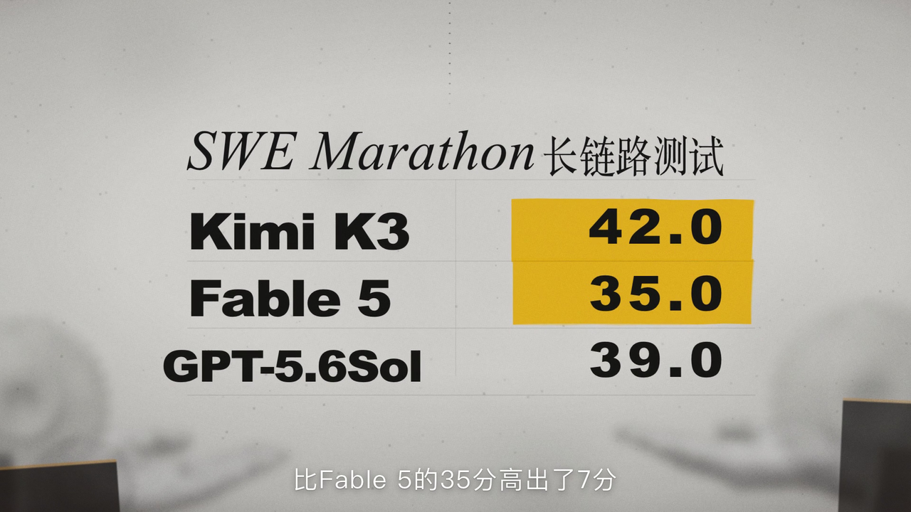

# SWE Marathon — 长链路测试

A frame-accurate-feeling **Remotion** recreation of an 8 second editorial motion
graphic: a photographed sheet of paper, heavy Ming display type printed with
registration ghosts, two gear cut-outs, a dotted "chain" that runs into a
leaderboard, and a highlighter swipe over the scores.

| | |
|---|---|
| Format | 1920 × 1080, 30 fps, 240 frames (8.0 s) |
| Composition id | `LongLinkTest` |
| Source clip | `1f6419af-0fba-4b69-b76f-55bdc6196a29` ("8月27日 (2)(1)-15") |
| Audio | none — the original narration/music is not reproduced |



## What the rebuild reproduces

**Look.** Warm grey paper stock generated from value noise (broad pulp cloud,
fibre streaks, dust, two soft creases), a halftone screen, film grain cycled
across three baked plates, a projector vignette, and a touch of chromatic
fringing. Everything is composited at 1920×1080 with a 0.45 px base softness so
the render reads as a photographed print rather than flat UI.

**Camera.** The collage lives on a 1920 × 2600 poster, but the track is not a
hand-keyed curve: it is 17 points *tracked from the reference* and sampled with
a monotone cubic spline (`src/lib/spline.ts`), so velocity stays continuous
through the whip-pan instead of stepping at every keyframe. Blur is directional
— an SVG `feGaussianBlur` with a vertical-only kernel, driven by the camera's
frame-to-frame velocity — which is what makes the whip read as a camera move
rather than a focus pull. A 1.02× push-in lands on the table afterwards.

**Entrance.** The opening is not one zoom: 长 slides in from the left, 链路
rises, 测试 drops in from the upper right with a −2° rotation, each with its own
settle time and blur, while the gears fall into the palms and the red kicker is
typed on at 0.9 chars/frame. All of them share one settle ease
(`cubic-bezier(.16,1,.3,1)`).

**Typography.** Black Songti for 长链路测试, italic Times for *SWE Marathon*,
Arial Black for the leaderboard, Helvetica for the red *Long link testing*
kicker, PingFang for the captions. Font stacks are macOS-first with free
fallbacks (see `src/theme.ts`).

**Motion, beat by beat**

| Time | Beat |
|---|---|
| f0–20 | layered entrance: 长 from the left, 链路 from below, 测试 from upper right, chromatic split settles |
| f0–36 | slow 95 px drift up the sheet |
| f36–72 | whip-pan (measured spline), directional motion blur peaks near f52 |
| f48–64 | table title, then row labels wipe in from the left |
| f55–110 | scores typed on, 2 frames per character |
| f106–126 | highlighter wipes down over 42.0 / 35.0 (slanted, ragged edge) |
| f236–239 | hard cut to the presenter shot (placeholder gradient — no footage) |
| 6.15–8.00 | final hold on the marked-up table |

Captions are transcribed from the source and cut on the same beats:

```
在这项长链路的测试里边   K3拿了42分   比Fable 5的35分高出了7分
也就是说                 K3赢的不只是页面做的好不好看
```

## Run it

```bash
npm install          # Node 18+; package-lock.json is committed
npm run dev          # Remotion Studio at http://localhost:3000
npm run render       # -> out/long-link-test.mp4
npm run still        # -> out/poster.png (frame 150)
npm run typecheck
```

`npm run render` writes H.264 / yuv420p at CRF 16. Remotion downloads its own
Chrome Headless Shell on first run.

## Project layout

```
src/
  index.ts               entry (registerRoot + global css)
  Root.tsx               composition registration
  LongLinkTest.tsx       scene assembly
  theme.ts               colours, font stacks, stage/poster/table geometry
  timeline.ts            camera track, blur, caption cues, row timing
  components/
    Camera.tsx           poster camera: pan + scale + rotation + velocity blur
    Paper.tsx            paper stock, grain, halftone, vignette, fringe, haze
    IntroCollage.tsx     title lock-up, gears, dotted chain, kicker
    ScoreTable.tsx       rules, mixed-script title, rows, per-glyph score reveal
    Marker.tsx           hand-wobbled highlighter polygons + wipe
    Foreground.tsx       screen-space hands and defocused debris
    Captions.tsx         lower-third cues
public/assets/           paper, grain plates, generated gear + hand cut-outs
tools/                   deterministic texture + cut-out generators
```

## Rebuilding the textures

The paper stock, grain plates and the alpha cut-outs are reproducible:

```bash
python3 tools/make-textures.py     # needs numpy + Pillow
python3 tools/cutout-assets.py     # keys the generated hand plates
```

The gear and hand photographs in `public/assets` were generated for this
project (plain white studio cut-outs), then trimmed, keyed and graded. The
textures are synthetic, so the repository ships no third-party imagery. No frame
of the reference clip is included — the reference was used only for timing,
composition and palette analysis.

## Notes

- **Fonts.** On macOS the piece uses Songti SC / Times / Arial Black /
  Helvetica Neue / PingFang SC. On other systems it falls back to Noto Serif SC,
  Noto Sans SC and the generic serif/sans stacks; letter-spacing and a couple of
  `scaleX` values in `ScoreTable.tsx` are tuned for the macOS faces.
- **Audio.** The source has narration. This rebuild is intentionally silent —
  drop an audio file in and add `<Audio src={staticFile('audio.mp3')} />` if you
  want it scored.
- **Tuning.** Camera keyframes live in `src/timeline.ts`; table geometry lives in
  `src/theme.ts`. Both are plain numbers, so the whole piece re-times without
  touching a component.

MIT licensed.
